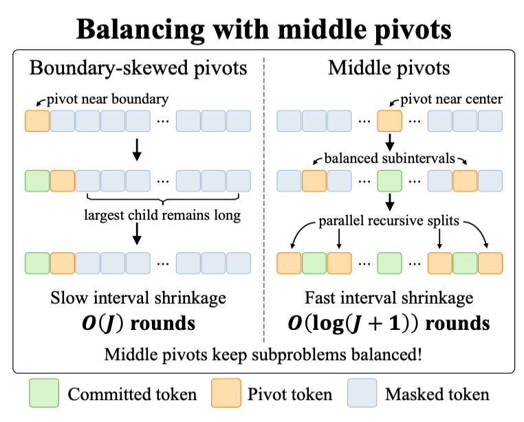
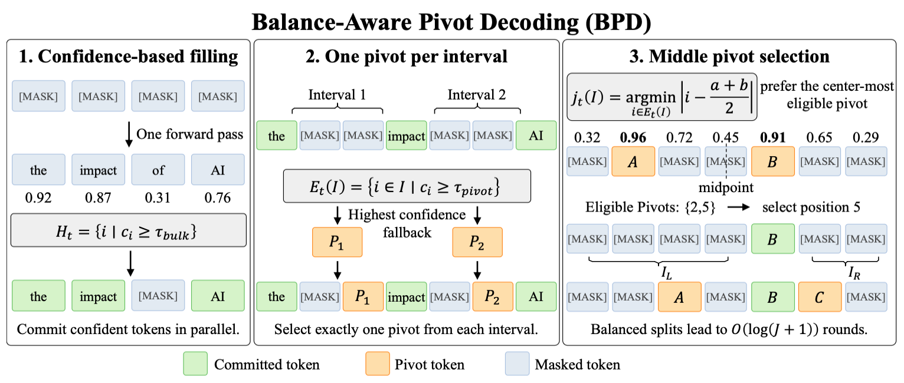
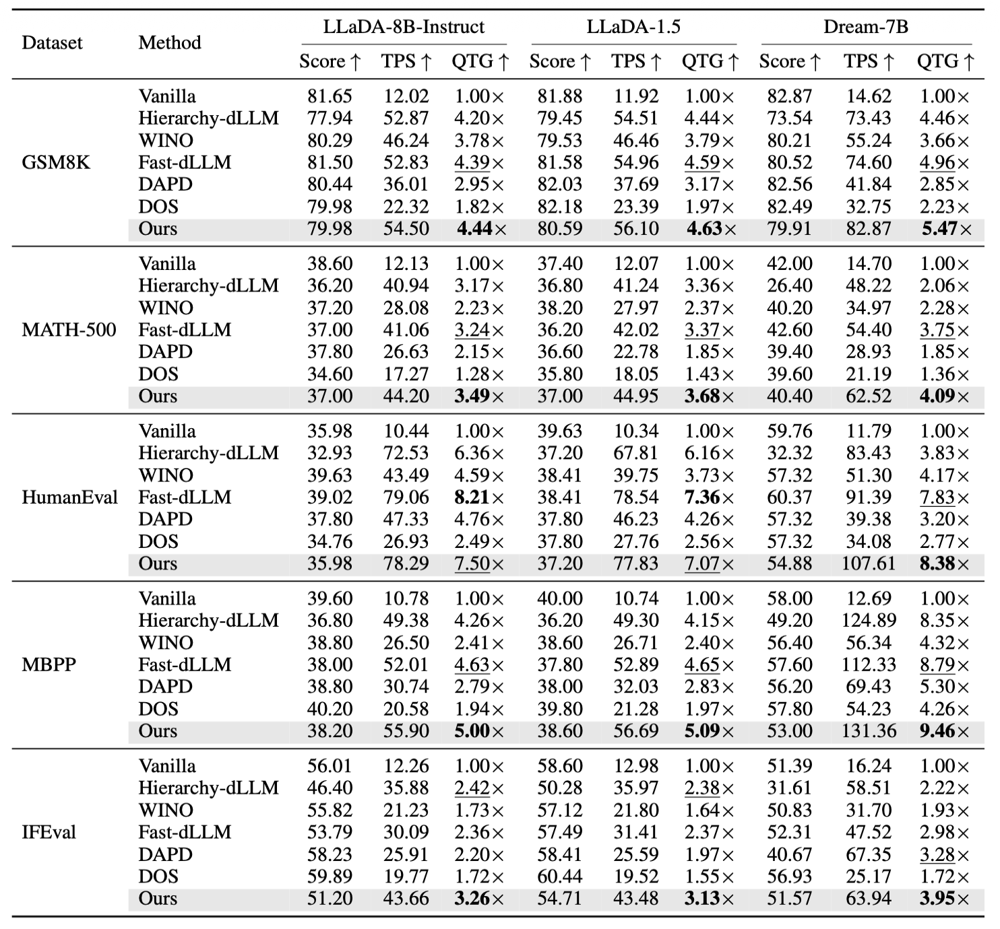

# Balance-Aware Pivot Decoding (BPD)

Training-free parallel decoding for masked diffusion LLMs (LLaDA, Dream).
BPD commits the **center** of every masked interval so that intervals split into balanced halves and finish in **O(log J)**.

> Anonymous code release for a paper under review.

- [Overview](#overview)
- [Results](#results)
- [Quick start](#quick-start)
- [Usage](#usage)
- [Repository layout](#repository-layout)
- [Output files](#output-files)

---

## Overview

### Why position matters

A diffusion LLM predicts every masked position in one forward pass, so the decoder decides *which* positions to commit at each step.
Existing accelerators pick by **confidence** only. Confidence says how reliable a token is, but not how the choice shapes the rest of the schedule:

<p align="center"></p>

- A pivot near the **boundary** of a masked interval leaves one long child behind. The interval shrinks one token per round: **O(J)** rounds.
- A pivot near the **center** leaves two balanced halves that are decoded in parallel: **O(log(J+1))** rounds.


### How BPD decodes a block

<p align="center"></p>

| Step | What happens |
|---|---|
| **1. Confidence-based prefilling** | For the first $K$ = 3 iterations, commit every masked token with confidence $\ge \tau_{bulk}$ in parallel. This gives reliable context and already cuts the block into short intervals. |
| **2. One pivot per interval** | Afterwards, every contiguous masked interval commits exactly one token per forward pass. All intervals progress at the same time. |
| **3. Middle pivot selection** | Inside an interval, pick the position closest to the center among those with confidence $\ge \tau_{bulk}$. If none qualifies, fall back to the most confident one. |

A prefix KV cache is built once per block and reused by every later iteration of that block.
Balanced splits are a *preference*, never forced onto uncertain predictions.

---

## Results

Setting: generation length 256, block size 32, $\tau_{bulk}$ = $\tau_{pivot}$ = 0.9, $K$ = 3, greedy decoding, one RTX A6000.

- **Score**: Pass@1 (`HumanEval`, `MBPP`) or accuracy (`GSM8K`, `MATH-500`, `IFEval` prompt-level strict)
- **TPS**: generated tokens per second
- **QTG**: relative TPS × relative score, both w.r.t. vanilla decoding

<p align="center"></p>

- Highest **QTG in 13 / 15** model-benchmark settings, highest **TPS in 12 / 15**.
- Within a few points of vanilla accuracy on GSM8K and MATH-500 at 3.6–5.7× throughput.
- Faster than Hierarchy-dLLM, the closest divide-and-conquer baseline, in all 15 settings at equal or higher scores.

The paper additionally reports an ablation, a comparison with bisection samplers, pivot-balance statistics, a threshold sweep and an IFEval early-termination analysis.

---

## Quick start

**1. Install**

```bash
pip install torch transformers datasets numpy accelerate
pip install nltk langdetect immutabledict absl-py      # IFEval only
```

**2. Clone the baselines you need** (next to the evaluation scripts)

```bash
git clone https://github.com/NVlabs/Fast-dLLM.git       # Fast-dLLM; also required for BPD on Dream
git clone https://github.com/Feng-Hong/WINO-DLLM.git    # WINO
git clone https://github.com/quasar529/DAPD.git         # DAPD
```

Hierarchy-dLLM and the bisection samplers are self-contained. Models and datasets are downloaded from Hugging Face on first use.

**3. Run BPD**

```bash
scripts/run_ours.sh 0 llada humaneval                   # GPU 0, LLaDA-8B-Instruct, HumanEval
```

Results land in `results/ours_llada_humaneval_g256_b32_t09/summary.json`.

---

## Usage

### BPD

The paper setting is `--n 1` (one pivot per interval) and `--confidence-threshold 0.9` (used as both τ_bulk and τ_pivot). K = 3 and the prefix cache are built in.

```bash
# HumanEval
python eval_humaneval_hf.py --model GSAI-ML/LLaDA-8B-Instruct --output results/humaneval_ours \
  --n 1 --confidence-threshold 0.9 --gen-length 256 --block-length 32

# GSM8K  (--num-samples 0 = full test set)
python eval_gsm8k_hf.py --model GSAI-ML/LLaDA-8B-Instruct --output results/gsm8k_ours \
  --n 1 --confidence-threshold 0.9 --gen-length 256 --block-length 32 --num-samples 0

# MATH-500 / MBPP / IFEval
python eval_bench_hf.py --task math500 --model GSAI-ML/LLaDA-8B-Instruct --output results/math500_ours \
  --n 1 --confidence-threshold 0.9 --gen-length 256 --block-length 32

# Dream-7B  (needs Fast-dLLM/)
python eval_humaneval_hf.py --model-family dream --model Dream-org/Dream-v0-Instruct-7B \
  --output results/humaneval_dream_ours --n 1 --confidence-threshold 0.9 --gen-length 256 --block-length 32
```

Runs are resumable: re-running with the same output directory skips finished examples.

| Flag | Purpose |
|---|---|
| `--limit N` / `--num-samples N` | smoke test on N problems (`--num-samples` for GSM8K) |
| `--shard k/n` | split MATH-500 / MBPP / IFEval over GPUs |
| `--model-family dream` | Dream-7B instead of LLaDA |
| `--local-files-only` | offline hosts |
| `--seed` | default 42; example *i* uses `seed + i` |

<!-- ### Queue scripts

Each script runs its jobs one after another on one GPU, with the paper configuration.

```bash
scripts/run_ours.sh      0 llada gsm8k math500 humaneval mbpp ifeval     # BPD
scripts/run_baseline.sh  0 llada gsm8k:vanilla gsm8k:hier gsm8k:wino gsm8k:fastdllm
scripts/run_dapd.sh      0 llada humaneval mbpp                          # ALG=dapd_direct | dapd_staged
bisection/run_bisection.sh 0 llada humaneval:margin:1                    # task:method:k
bisection/run_sweep.sh   0 dream 1 2 4                                   # full bisection sweep
```

Outputs: `results/<prefix>_<label>_<task>_g<gen>_b<block>_<method>/` and `logs/<same>.out`. -->

Environment overrides, shared by all scripts:

| Variable | Meaning |
|---|---|
| `MODEL`, `MODEL_LABEL` | checkpoint and its tag in result names, e.g. `MODEL=GSAI-ML/LLaDA-1.5 MODEL_LABEL=llada15` |
| `GEN`, `BLOCK` | generation / block length (256 / 32) |
| `LIMIT` | smoke test on N problems; results go to `smoke_<prefix>_...` |
| `DATASET`, `DATA_DIR` | local Arrow file, or a directory holding `<task>.arrow` |
| `OFFLINE=1` | cached model files only |
| `DRY=1` | print the commands instead of running them |

### Baselines

Pick decoders with `--methods`, or fix their hyperparameters with a `--variant-config` JSON (examples in `configs/`).

```bash
# vanilla + Hierarchy-dLLM in one process
python eval_bench_hf.py --task mbpp --model GSAI-ML/LLaDA-8B-Instruct --output results/mbpp_baselines \
  --methods low_confidence hierarchy --gen-length 256 --block-length 32 --steps 256

# with a config
python eval_humaneval_hf.py --model GSAI-ML/LLaDA-8B-Instruct --output results/humaneval_hier \
  --variant-config configs/hierarchy_r03_variant.json --gen-length 256 --block-length 32
```

A config maps a label to a decoder and its options:

```json
{"hierarchy_h082_l03_r03": {"decoder": "hierarchy", "threshold": 0.82, "low_threshold": 0.3, "remask_threshold": 0.3}}
```

<details>
<summary><b>Decoder options</b></summary>

| `decoder` | Options (default) |
|---|---|
| `ours` | `n` pivots per interval, `confidence_threshold`, `remask_k` (0), `logits_eos_inf` |
| `low_confidence`, `random`, `random_pivot` | none; `--steps` forwards per sequence |
| `hierarchy` | `threshold` (0.82), `low_threshold` (0.3), `remask_threshold` (0.3) |
| `wino` | `threshold` (0.6), `threshold_back` (0.9) |
| `fastdllm` | `threshold` (0.9), `cache` = `null` / `prefix` / `dual` |
| `dapd` | `alg` = `dapd_direct` / `dapd_staged`, `tau_min`, `tau_max`, `layer_ratio` (0.3) |
| `bisection` | `k` (1), `score` = `null` / `entropy` / `margin` / `confidence`, `top_p` |

Notes
- `remasking` is accepted in place of `decoder`; `confidence_pivot_v2` is an alias of `ours`.
- WINO and Fast-dLLM load their own model implementations, and BPD on Dream uses Fast-dLLM's Dream modeling, so each of them must be the only decoder in its process.
- Every decoder runs with temperature 0, batch size 1 and no classifier-free guidance.
- The DOS baseline is not part of this repository.

</details>

<!-- ---

## Repository layout

```
decode_confidence_v2.py        BPD (ours) on LLaDA: prefilling, one center pivot per interval, prefix KV cache
decode_confidence_v2_dream.py  BPD on Dream, on top of Fast-dLLM's Dream modeling
eval_humaneval_hf.py           HumanEval harness
eval_gsm8k_hf.py               GSM8K harness
eval_bench_hf.py               MATH-500 / MBPP / IFEval harness (--task)
eval_models.py                 model loading and baseline registry

decode.py                      vanilla low-confidence remasking (+ random / random_pivot)
hierarchy_decode.py            Hierarchy-dLLM
wino_decode.py                 WINO                      (needs WINO-DLLM/)
fastdllm_decode.py             Fast-dLLM on LLaDA        (needs Fast-dLLM/)
fastdllm_dream_decode.py       Fast-dLLM on Dream        (needs Fast-dLLM/)
dapd_decode.py                 DAPD                      (needs DAPD/)
bisection/                     bisection samplers, see bisection/README.md
dream_adapter.py               runs the LLaDA-style decoders on Dream

scripts/                       queue scripts (run_ours.sh, run_baseline.sh, run_dapd.sh, common.sh)
configs/                       variant configs used by the scripts
ifeval_lib/                    IFEval instruction checkers
report_dapd.py                 tables from results/dapd_*  (bisection/report_bisection.py likewise)
```

--- -->

## Output files

Every run writes to its `--output` directory:

| File | Content |
|---|---|
| `summary.json` | per-decoder aggregates, refreshed after every example |
| `results.jsonl` | one record per example: text, correctness, token counts, time, per-step statistics |
| `config.json` | full configuration, library versions, source hashes |
| `source/` | copy of the decoder and harness files that produced the run |

Keys in `summary.json` behind the paper's metrics:

| Metric | Key |
|---|---|
| Score | `pass_at_1_percent` (HumanEval, MBPP), `accuracy_percent` (GSM8K, MATH-500), `prompt_strict_accuracy_percent` (IFEval) |
| TPS | `final_tokens_per_second` |
| Forward passes | `mean_forward_steps` |
